# Ticket flow map

Every path a ticket can take through factory. The native dashboard Atlas
(`/?view=atlas`, [implementation](../factory/workspace-tools.js))
shows the pieces; this map shows the paths. Edge labels cite the implementing
symbol in `factory/`; the tables below are the full index and
`tests/test_ticket_flow_map.py` fails when they drift from the code in either
direction. Operator commands live in the [README](../README.md) and skills, not here.

## Legend

| Kind | Meaning | Drawn as |
|------|---------|----------|
| View | A stage of the pipeline | subgraph |
| State | A label or durable outcome a ticket or PR can be in | stadium `([state])` |
| Action | What factory does | rectangle `[action]` |
| Out | Leaves factory: human, reporter, external CI | hexagon `{{out}}` |
| Gap | Path in code but not what the label suggests, or a path people expect that code lacks | dashed edge `-.->` |

## Map

```mermaid
flowchart TB
  subgraph intake["View: Intake and triage"]
    NV(["needs-viability"])
    NT(["needs-triage"])
    NI(["needs-info"])
    INIT(["initiative"])
    VIA["manager viability verdict"]
    TRI["triage: deterministic pre-check, then model decision"]
  end

  subgraph build["View: Build"]
    RFA(["ready-for-agent"])
    CLAIM["claim, assign, worktree agent/N"]
    WR["worker round: worker then gate"]
    PUSH["push branch, open PR"]
    REV["independent review: APPROVE or REVISE"]
  end

  subgraph approve["View: Approval and merge"]
    MAPP["manager PR frontier"]
    FA(["factory-approved"])
    REF["refresh onto main: re-gate, re-review, re-approve"]
    MERGE["merge one PR per pass"]
    MERGED(["merged, issue closed by PR"])
  end

  subgraph recover["View: Recovery"]
    ESC["escalate with packet"]
    RFH(["ready-for-human"])
    MGR["manager decision"]
    WONT(["wontfix-proposal"])
  end

  REPORTER{{"Reporter answers"}}
  HUMAN{{"Human decides"}}
  CI{{"GitHub CI checks"}}
  UPSTREAM{{"Upstream main moved"}}
  EXTPR{{"Opted-in external PR"}}

  %% Intake and triage
  NV -->|"manage.viability_pass"| VIA
  VIA -->|"BUILD: manage.viability_pass"| NT
  VIA -->|"DEFER, opt-in label removed: manage.viability_pass"| HUMAN
  INIT -->|"refused at every stage: plan.is_initiative"| HUMAN
  NT -->|"triage.execute"| TRI
  TRI -->|"too short or no acceptance: triage.deterministic_needs_info"| NI
  TRI -->|"triage.apply_decision"| NI
  TRI -->|"triage.apply_decision"| RFA
  TRI -->|"triage.apply_decision"| RFH
  TRI -->|"unparseable twice, label kept: triage.execute"| NT
  TRI -->|"triage.apply_decision"| WONT
  NI -->|"question comment: triage.apply_decision"| REPORTER
  REPORTER -.->|"no watcher re-queues needs-info; a human relabels: decisions.apply"| NT

  %% Build
  RFA -->|"open, unassigned, no open blockers: dispatch.frontier"| CLAIM
  RFA -->|"bot-only assignment, no live lock, unsafe worktree: dispatch.frontier"| ESC
  RFA -->|"its PR's red CI completed before the release: no escalation, waits for a worker: manage.frontier_pass"| CLAIM
  RFA -->|"its PR's CI red after the release, or idle stale_days counted from the release: manage.frontier_pass, manage.released_at"| ESC
  CLAIM -->|"dispatch.process_ticket"| WR
  WR -->|"gate FAIL or worker stuck, attempts left, report fed back: dispatch.process_ticket"| WR
  WR -->|"gate FAIL or stuck max_attempts, protected paths, or budget: dispatch.process_ticket"| ESC
  WR -->|"gate PASS: dispatch.worker_round"| PUSH
  PUSH -->|"nothing ahead of main or PR target mismatch: dispatch.push_and_pr"| ESC
  PUSH -->|"dispatch.review"| REV
  REV -->|"REVISE or pr-tier gate FAIL, review_rounds left: dispatch.process_ticket"| WR
  REV -->|"REVISE or pr-tier gate FAIL after review_rounds, bounce gate FAIL or stuck, or budget: dispatch.process_ticket"| ESC
  REV -->|"APPROVE, evidence bound to head: dispatch.approve_pr"| FA
  REV -->|"APPROVE but head or human review changed: dispatch.process_ticket"| ESC
  REV -->|"APPROVE, manager.review = all: dispatch.approve_pr waits"| MAPP

  %% Approval and merge
  MAPP -->|"manager APPROVE: manage.frontier_pass"| FA
  MAPP -->|"CI fail, late feedback, stale, rounds exhausted, HUMAN: manage.frontier_pass"| ESC
  FA -->|"late feedback or stale past stale_days, any manager.review mode: manage.frontier_pass"| ESC
  MAPP -.->|"CI cancel still treated as fail before approval: manage.frontier_pass"| ESC
  PUSH -->|"agent/<n> push refused, remote moved since the lease was read: dispatch.push_agent"| ESC
  CLAIM -->|"any other dispatcher exception after the claim, then re-raised: dispatch.process_ticket"| ESC
  MAPP -->|"FIX or CLOSE: manage.apply"| MGR
  FA -->|"dispatch.pr_checks"| CI
  CI -->|"pending: dispatch.merge_pass_locked waits"| FA
  CI -->|"fail or cancel after steps ran, approval removed: dispatch.merge_pass_locked"| ESC
  CI -->|"cancel before any runner: rerun once, wait: dispatch.triage_cancelled"| FA
  CI -->|"rerun still found no runner, approval kept: dispatch.runner_unavailable"| ESC
  CI -->|"pass, behind main, approval removed: dispatch.refresh_pr_branch"| REF
  REF -->|"dispatch.approve_pr"| FA
  REF -->|"conflict, open ticket, rounds left, no unauthorized protected path: claim released, ready-for-human removed, ready-for-agent added, worker rebases on agent/N: dispatch.refresh_pr_branch"| RFA
  REF -->|"conflict on a protected path without override, after review_rounds conflict rounds, or ticket not open; gate FAIL, REVISE, or head moved: dispatch.refresh_pr_branch"| ESC
  CI -->|"pass, missing SHA-bound approval evidence: dispatch.merge_pass_locked"| ESC
  CI -->|"pass, up to date, no human CHANGES_REQUESTED: dispatch.merge_pass_locked"| MERGE
  MERGE -->|"dispatch.cleanup_after_merge"| MERGED
  TRI -->|"bug filed by factory watch (journaled issue, fingerprint, runtime title), no model, fixed investigation brief: triage.triage_issue"| RFA
  RFA -->|"unclaimed watch issue, newest evidence 24 hours old, issue closed completed: watch.run_pass"| HUMAN
  NT -->|"untriaged watch issue, newest evidence 24 hours old, issue closed completed: watch.run_pass"| HUMAN

  %% Recovery
  ESC -->|"ready-for-agent swapped for ready-for-human: dispatch.escalate"| RFH
  UPSTREAM -->|"new sync ticket on a staged agent/N candidate; never moves main: dispatch.sync_pass"| RFA
  EXTPR -->|"review attempts exhausted, new issue: dispatch.review_intake_pass"| RFH
  EXTPR -->|"agent/lessons-*, agent/curate-*, agent/revert-lessons-* (same repository) admitted without a label: dispatch.review_intake_pass"| EXTPR
  EXTPR -->|"gate PASS + APPROVE bound to head, CI green: learn.promote_pass"| MERGED
  RFH -->|"packet and manager rounds left: manage.escalation_pass"| MGR
  RFH -->|"terminal, routed request published: handoff.handoff_pass"| HUMAN
  MGR -->|"RETRY, REWRITE, or ROUTE: manage.apply"| RFA
  MGR -->|"AUTHORIZE adds add-only authority before requeue: manage.apply"| RFA
  MGR -->|"SPLIT, children opened, parent stays: manage.apply"| NT
  MGR -->|"FIX: worker round, gate, review: manage.apply"| FA
  MGR -->|"FIX fails gate, pr-tier gate, or review; kept head not the PR head plus the worker's own commits, or their lease push refused: manage.apply"| ESC
  MGR -->|"CLOSE PR on an original ticket: manage.apply"| WONT
  MGR -->|"CLOSE PR on a SPLIT child, issue closed not planned: manage.apply"| HUMAN
  MGR -->|"RESOLVE: evidence comment, issue closed completed: manage.apply"| HUMAN
  MGR -->|"HUMAN or manager failed, label kept: manage.escalation_pass"| HUMAN
  WONT -->|"a human decides: config.LABELS"| HUMAN
  HUMAN -->|"relabel, comment, close, approve: decisions.apply"| RFA

  classDef state fill:#e8f5e9,stroke:#2e7d32
  classDef out fill:#fff3e0,stroke:#e65100
  class NV,NT,NI,INIT,RFA,FA,MERGED,RFH,WONT state
  class REPORTER,HUMAN,CI,UPSTREAM,EXTPR out
```

## Gaps

- **CI `cancel` is `fail` before approval.** Since #164 the merge stage reruns a
  check cancelled before any runner picked it up (`dispatch.triage_cancelled`), but
  `manage.frontier_pass` still buckets `cancel` with `fail`, so an infrastructure
  cancel on an unapproved PR escalates as "CI failed".
- **`needs-info` has no re-entry.** Nothing watches for the reporter's answer; a human
  puts `needs-triage` back (`decisions.apply` or GitHub).
- **Data-driven labels.** Rows marked `*` below edit labels chosen at runtime:
  the triage decision, manager ROUTE, the viability opt-in label, the human
  decision, and the `chore` PR label `learn.chore_pr` passes.

## Label transitions

One row per function that edits labels (`--add-label`, `--remove-label`, or
`--label` on `gh ... create`). `*` is a label chosen at runtime.

| Code | Removes | Adds | Path |
|------|---------|------|------|
| `decisions._approve` | — | `factory-approved` | Human approve step; withdrawn again if the PR changed while labelling |
| `decisions._plan_request` | `*` | `*` | Human action; labels limited to `decisions.ACT_LABELS`, `factory-approved` routed to `decisions._approve` |
| `decisions._withdraw_approval` | `factory-approved` | — | Human approve step found the PR changed |
| `dispatch.approve_pr` | `factory-approved` | `factory-approved` | Approve; withdraw again if the PR changed while labelling |
| `dispatch.escalate` | `ready-for-agent` | `ready-for-human` | Every escalation |
| `dispatch.merge_pass_locked` | `factory-approved` | — | CI fail, or cancel after steps ran; missing approval evidence |
| `dispatch.push_and_pr` | — | `*` | Caller's PR label; ticket PRs pass none |
| `dispatch.refresh_pr_branch` | `factory-approved`, `ready-for-human` | `ready-for-agent` | Behind main: approval withdrawn before refresh; eligible conflict requeues restore agent flow |
| `dispatch.review_intake_pass` | — | `ready-for-human` | New issue for an unresolved opted-in PR review |
| `dispatch.sync_issue` | — | `ready-for-agent` | New sync ticket for new upstream commits; its `agent/N` candidate carries the merge and gate evidence |
| `learn.promote` | — | `factory-approved` | `factory learn` PR (lessons, curate, revert-lessons) with head-bound gate PASS, reviewer APPROVE and green CI, then squash merge (`learn.promote_pass` runs it per PR); lessons/curate merges open a `promotion-open` that `learn.decide_promotions` keeps or reverts |
| `manage.apply` | `ready-for-human`, `*` | `factory-add-only-override`, `ready-for-agent`, `needs-triage`, `wontfix-proposal`, `*` | AUTHORIZE grants add-only authority and requeues; RETRY/REWRITE/ROUTE return to agent; SPLIT children; CLOSE; RESOLVE closes completed; ROUTE labels |
| `manage.viability_pass` | `*` | `needs-triage` | Opt-in label removed; BUILD queues triage |
| `triage.apply_decision` | `needs-triage` | `*` | `*` is the decision: `ready-for-agent`, `needs-info`, `ready-for-human`, or `wontfix-proposal` |
| `watch.run_pass` | — | `*` | New `bug` + `needs-triage` issue per runtime-failure fingerprint (`watch.LABELS`) |

## Escalate reasons

Every reason string passed to `dispatch.escalate`, the
`withdraw` helper in `dispatch.refresh_pr_branch`, or recorded as an `escalate`
event. `{}` is a runtime value.

| Code | Reason | Edge |
|------|--------|------|
| `dispatch.frontier` | ``worktree path is not a directory: {}`` | ready-for-agent orphan → escalate (`orphaned_claim`) |
| `dispatch.frontier` | ``worktree is mid-merge: {}`` | ready-for-agent orphan → escalate (`orphaned_claim`) |
| `dispatch.frontier` | ``worktree state is unreadable: {}`` | ready-for-agent orphan → escalate (`orphaned_claim`) |
| `dispatch.frontier` | ``worktree has uncommitted changes: {}`` | ready-for-agent orphan → escalate (`orphaned_claim`) |
| `dispatch.process_ticket` | ``worker edited protected paths`` | worker round → escalate |
| `dispatch.process_ticket` | ``worker removed or changed existing tests`` | worker round → escalate (add-only path) |
| `dispatch.process_ticket` | ``wall-clock budget ({} min) exceeded`` | worker round → escalate |
| `dispatch.process_ticket` | ``gate failed {} times; worktree kept at {}`` | worker round → escalate |
| `dispatch.process_ticket` | ``idle_timeout fired (worker stuck) on attempt {}; worktree kept at {}`` | worker round → escalate |
| `dispatch.process_ticket` | ``agent/{}: worker committed nothing over {}; read the handoff`` | push → escalate (`no_change`, only when the handoff exists; `factory watch` never files it) |
| `dispatch.process_ticket` | ``agent/{}: PR not published (no commits over main and no handoff, or existing PR targets a base other than {}); inspect dispatcher log`` | push → escalate |
| `dispatch.process_ticket` | ``wall-clock budget ({} min) exceeded before bounce {}`` | review → escalate |
| `dispatch.process_ticket` | ``gate failed after review bounce {}; worktree kept at {}`` | review → escalate |
| `dispatch.process_ticket` | ``idle_timeout fired (worker stuck) after review bounce {}; worktree kept at {}`` | review → escalate |
| `dispatch.process_ticket` | ``REVISE verdict after {} review round(s)`` | review → escalate |
| `dispatch.process_ticket` | ``reviewer unavailable after retries`` | review tooling retries exhausted → escalate (`reviewer_unavailable`) |
| `dispatch.process_ticket` | ``pr checks failed`` | review → escalate |
| `dispatch.process_ticket` | ``approval evidence, head, or human review state changed before approval`` | review → escalate |
| `dispatch.process_ticket` | ``dispatcher error: {}; worktree kept at {}`` | any post-claim exception → escalate (`dispatcher_error`), then re-raised; a `LeaseRefused` from `dispatch.push_agent` escalates as `lease_refused` with its own message |
| `dispatch.merge_pass_locked` | ``PR #{}: CI failed ({}); `{}` label removed`` | CI fail → escalate |
| `dispatch.runner_unavailable` | ``PR #{}: CI runner unavailable ({}) in run {}; `{}` kept`` | CI no runner after rerun → escalate |
| `dispatch.merge_pass_locked` | ``PR #{}: missing approval evidence bound to {}; `{}` label removed`` | CI pass, missing evidence → escalate |
| `dispatch.refresh_pr_branch` | ``PR #{}: could not remove stale `{}` approval`` | refresh → escalate |
| `dispatch.refresh_pr_branch` | ``PR #{}: {}; `{}` label removed`` | refresh → escalate (wraps the reasons below) |
| `dispatch.refresh_pr_branch` | ``kept worktree head {} differs from remote head {}`` | refresh → escalate |
| `dispatch.refresh_pr_branch` | ``{} onto moved main conflicts (protected paths without `{}`); worktree {}`` | refresh → escalate immediately, conflict file list in the packet |
| `dispatch.refresh_pr_branch` | ``{} onto moved main conflicts (after {} conflict-resolution round(s)); worktree {}`` | refresh → escalate once `review_rounds` conflict requeues are used up, conflict file list in the packet |
| `dispatch.refresh_pr_branch` | ``{} onto moved main conflicts (ticket is not open); worktree {}`` | refresh → escalate (ticket is no longer open) |
| `dispatch.refresh_pr_branch` | ``nothing ahead of {} after {}; refusing to push`` | refresh → escalate |
| `dispatch.refresh_pr_branch` | ``gate failed after {} onto moved main`` | refresh → escalate |
| `dispatch.refresh_pr_branch` | ``remote head changed while refreshed evidence was being produced`` | refresh → escalate |
| `dispatch.refresh_pr_branch` | ``fresh review requested changes after {} onto moved main`` | refresh → escalate |
| `dispatch.refresh_pr_branch` | ``reviewer unavailable after {} onto moved main`` | refreshed review tooling retries exhausted → escalate (`reviewer_unavailable`) |
| `dispatch.refresh_pr_branch` | ``approval evidence, head, or human review state changed before refreshed approval`` | refresh → escalate |
| `dispatch.review_intake_pass` | ``PR #{}: unresolved after {} automated review attempt(s)`` | external PR → ready-for-human |
| `manage.frontier_pass` | ``PR #{}: CI failed ({})`` | manager PR frontier → escalate |
| `manage.frontier_pass` | ``PR #{}: {} unresolved feedback item(s) on head {}`` | manager PR frontier → escalate |
| `manage.frontier_pass` | ``PR #{}: no activity for {} days (stale_days = {})`` | manager PR frontier → escalate |
| `manage.frontier_pass` | ``PR #{}: manager rounds exhausted before approval`` | manager PR frontier → escalate |
| `manage.frontier_pass` | ``PR #{}: approval evidence, head, or human review state changed before manager approval`` | manager PR frontier → escalate |
| `manage.frontier_pass` | ``PR #{}: manager requires a human: {}`` | manager PR frontier → escalate |
| `manage.apply` | ``gate failed after manager FIX`` | manager FIX → escalate |
| `manage.apply` | ``review requested changes after manager FIX`` | manager FIX → escalate |
| `manage.apply` | ``reviewer unavailable after manager FIX`` | manager FIX review tooling retries exhausted → escalate (`reviewer_unavailable`) |
| `manage.apply` | ``pr checks failed`` | manager FIX → escalate |
| `manage.apply` | ``approval evidence, head, or human review state changed before manager FIX approval`` | manager FIX → escalate |
| `manage.apply` | ``FIX worktree head {} is not the PR head {} plus the worker's own commits; worktree kept at {}`` | manager FIX → escalate (`refresh_head`) |
| `manage.apply` | ``FIX could not push the worker's own commits: origin/agent/{} moved since {}; worktree kept at {}`` | manager FIX → escalate (`lease_refused`) |
| `manage.escalation_pass` | ``manager_failed`` | manager decision → human |
